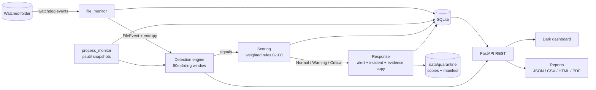

# RDRS - Ransomware Detection and Response System


**Authors:** Habebur Rahman and Aleena K Mani (internship project, Internmo)

RDRS is a **defensive**, rules-based tool that watches a folder for ransomware-like behaviour (many files rewritten with
random-looking content, mass extension changes), scores the threat 0-100 with a fully **explainable** breakdown, raises
alerts, preserves evidence and produces incident reports. **Simulation mode is ON by default**: RDRS never kills a
process and never modifies or deletes your files (evidence is *copied*).

> Educational / defensive use only. No malware is written or run. Testing uses a harmless script that only touches
> `data/sandbox`.

## Contents
1. [Highlights](#highlights) 2. [Architecture](#architecture) 3. [What you need (all systems)](#what-you-need)
4. [Install and run: Windows / macOS / Linux](#install-and-run) 5. [Docker (all systems)](#docker)
6. [Using the dashboard](#using-the-dashboard) 7. [Configuration](#configuration) 8. [Scoring](#scoring)
9. [REST API](#rest-api) 10. [Reports](#reports) 11. [Tests and code quality](#tests-and-code-quality)
12. [Troubleshooting](#troubleshooting) 13. [Security notes](#security-notes) 14. [Authors](#authors) 15. [License](#license)

## Highlights
- **Explainable score**: every alert shows which signal added how many points.
- **File-type aware entropy**: `.zip/.jpg/.mp4/...` are naturally high-entropy and are ignored (fewer false positives).
- **Live dashboard** with a *Simulate Attack* button, score timeline, entropy/CPU chart and one-click reports.
- **MTTD** (time to detect) is measured for every incident.
- Evidence is copied with **SHA-256 hashes** (`manifest.json`); one incident per attack, and it keeps growing while the attack continues.
- 51 automated tests (~98% coverage), ruff-clean, Docker image, GitHub Actions CI.

## Architecture

| Layer | Path | Responsibility |
|---|---|---|
| core | `app/core/` | config, logging, entropy, scoring (pure logic), shared models |
| detectors | `app/detectors/` | file monitor, process monitor, detection engine, incident response |
| database | `app/database/` | SQLAlchemy models + thread-safe SQLite access |
| api | `app/api/` | REST endpoints, sandbox simulator |
| dashboard | `app/dashboard/` | single-page dark UI (no external CDN, works offline) |
| reports | `app/reports/` | incident report generator (+ CLI) |

## What you need
| Tool | Needed for | Notes |
|---|---|---|
| **Python 3.12 or newer** | running from source | Tested on 3.12 and 3.14. Includes `pip` and `venv` (on Debian/Ubuntu install `python3-venv` separately). |
| **Git** | cloning the repo | Optional: you can also download the ZIP from GitHub. |
| **Docker** | running the container | Optional. Docker Desktop (Windows/macOS) or Docker Engine (Linux). |
| A web browser | dashboard | Any modern browser. |

No compiler is needed: every Python dependency ships prebuilt wheels. Python packages (installed automatically from
`requirements.txt`): watchdog, psutil, pyyaml, loguru, sqlalchemy, fastapi, uvicorn, jinja2, reportlab.
Developer extras (`requirements-dev.txt`): httpx, pytest, pytest-cov, ruff. You never need admin/root rights to run RDRS.

Tested on: **Windows 11 + Python 3.14**, **Linux (Ubuntu) + Python 3.12** and GitHub Actions (Ubuntu, Python 3.12 and 3.14),
and Docker Desktop on Windows. macOS is expected to work but has not been tested by the authors.

## Install and run

### Windows 10/11 (PowerShell)
1. Install **Python** from <https://www.python.org/downloads/> - tick **"Add python.exe to PATH"** in the installer.
   Install **Git** from <https://git-scm.com/download/win>. Check: `python --version` and `git --version`.
2. Get the code and set it up:
```powershell
git clone https://github.com/rahman56661/rdrs.git
cd rdrs
python -m venv .venv
.venv\Scripts\Activate.ps1
pip install -r requirements-dev.txt
```
   If PowerShell says *"running scripts is disabled"*, run once: `Set-ExecutionPolicy -Scope CurrentUser RemoteSigned`
   (or use `.venv\Scripts\activate.bat` in Command Prompt).
3. Check everything works, then start RDRS:
```powershell
pytest --cov=app
python -m app.main --watch data/sandbox
```
4. Open **http://127.0.0.1:8765/**. Stop with `Ctrl+C`.

### macOS
1. Install [Homebrew](https://brew.sh), then: `brew install python@3.12 git`
   (or install Python from python.org). Check: `python3 --version`.
2. Set up and run:
```bash
git clone https://github.com/rahman56661/rdrs.git
cd rdrs
python3 -m venv .venv
source .venv/bin/activate
pip install -r requirements-dev.txt
pytest --cov=app
python -m app.main --watch data/sandbox
```
3. Open **http://127.0.0.1:8765/**.
   Note: macOS does not expose per-process disk-write counters, so the "suspect process" falls back to
   CPU activity and "runs near the watched folder".

### Linux (Debian / Ubuntu / Fedora / Arch)
1. Install the tools:
```bash
# Debian / Ubuntu / Mint
sudo apt update && sudo apt install -y python3 python3-venv python3-pip git
# Fedora
sudo dnf install -y python3 python3-pip git
# Arch
sudo pacman -S --needed python python-pip git
```
   You need Python 3.12+ (`python3 --version`). On older distributions install it from your package manager's
   newer-Python repo or with [pyenv](https://github.com/pyenv/pyenv).
2. Set up and run:
```bash
git clone https://github.com/rahman56661/rdrs.git
cd rdrs
python3 -m venv .venv
source .venv/bin/activate
pip install -r requirements-dev.txt
pytest --cov=app
python -m app.main --watch data/sandbox
```
3. Open **http://127.0.0.1:8765/**. If you watch a very large folder and see an inotify error, raise the limit:
   `sudo sysctl fs.inotify.max_user_watches=524288`.

### Optional: simulate from the terminal (any OS)
With RDRS running in one terminal, open a second terminal in the project folder (activate the venv) and run:
```
python scripts/simulate_attack.py attack     # random bytes + .locked rename  -> Critical
python scripts/simulate_attack.py normal     # ordinary edits                 -> stays Normal
python scripts/simulate_attack.py zip        # random .zip files              -> stays Normal
```
The script only touches `data/sandbox`.

## Docker
Docker runs RDRS in an isolated container, so you do not need Python installed.

**1. Install and START Docker first**
- **Windows / macOS:** install [Docker Desktop](https://www.docker.com/products/docker-desktop/), **open it and wait until it
  says "Engine running"**. Check with `docker version` (you must see both *Client* and *Server*).
- **Linux:** install Docker Engine + Compose plugin (<https://docs.docker.com/engine/install/>), e.g. on Ubuntu
  `sudo apt install -y docker.io docker-compose-v2`, then `sudo systemctl enable --now docker` and
  `sudo usermod -aG docker $USER` (log out and in once).

**2. Build and run from source**
```bash
git clone https://github.com/rahman56661/rdrs.git
cd rdrs
docker compose up --build            # first build takes 1-3 minutes
```
Open **http://localhost:8765**. (The log line may show `0.0.0.0` - that is just the address inside the container.)

| Task | Command |
|---|---|
| Run in the background | `docker compose up -d --build` |
| Follow logs | `docker compose logs -f` |
| Stop | `Ctrl+C`, or `docker compose down` |
| Stop and delete the database/reports volume | `docker compose down -v` |

**3. Or run the ready-made image from GitHub Container Registry** (built automatically by CI on every push to `main`)
```bash
docker run --rm -p 127.0.0.1:8765:8765 ghcr.io/rahman56661/rdrs:latest
```
(If the pull is denied, the package is still private: on GitHub open *Packages -> rdrs -> Package settings -> Change visibility -> Public*.)

Inside Docker, RDRS watches the container's own `data/sandbox` and sees only the container's processes. The *Simulate Attack*
button works inside the container. Data is kept in named volumes `rdrs-data` and `rdrs-logs`.

## Using the dashboard
1. **Reset sandbox + window** -> clean start.  2. **Normal activity** -> stays *Normal*.
3. **ZIP backup (false-positive test)** -> stays *Normal*.  4. **Simulate Attack** -> *Warning*, then **Critical**
   with the explanation ("why this score"), an incident, copied evidence and a measured MTTD.
5. In the *Incidents* table click **Generate** to create the report and open it (html / pdf / json / csv).
6. **Scan now** lists files in the watched folder that currently look encrypted.

## Configuration
Everything is in `config.yaml`:

| Key | Meaning |
|---|---|
| `watch_paths` | folders to monitor (keep it a sandbox) |
| `simulation_mode` | `true` = never terminate anything |
| `detection.window_seconds` | sliding window length (default 60) |
| `detection.thresholds / weights / levels` | rule limits, points per signal, Warning/Critical bands |
| `detection.trusted_processes` | programs that do not add the "unknown program" points |
| `response.quarantine_dir` | evidence folder (must be outside the watched folders) |
| `api.host / api.port` | dashboard address (default `127.0.0.1:8765`) |

Environment overrides (handy for Docker/CI): `RDRS_API_HOST`, `RDRS_API_PORT`, `RDRS_WATCH_PATHS` (comma separated).
Thresholds and weights can also be changed live through `POST /settings`.

## Scoring
| Signal | Points | Fires when |
|---|---|---|
| rapid_encryption | 40 | >= 20 high-entropy files in the 60 s window |
| mass_rename | 30 | >= 15 renames that change the extension |
| high_entropy | 25 | average entropy of recent writes >= 7.0 |
| cpu_spike | 15 | a process uses >= 80% of total CPU (only while suspicious file activity is ongoing) |
| unknown_program | 10 | the likely writer is not in the trusted list (same condition) |

Score is capped at 100. **Normal 0-39, Warning 40-69, Critical 70-100.**

## REST API
Interactive docs at `/docs`.
`GET /health /status /alerts /events /incidents /scores /history /top-files /reports /settings` -
`POST /scan /settings /simulate/{attack|normal|zip} /simulate/reset /reports/{incident_id}` -
`GET /reports/download/{file}`.

## Reports
Use the dashboard **Generate** button, or the command line (venv active):
```
python -m app.reports.generator --latest      # or --incident 3
```
Output: `data/reports/incident_<id>.{json,csv,html,pdf}` (score breakdown, MTTD, suspect, affected files, attack timeline, recommendations).

## Tests and code quality
```
pytest --cov=app        # 51 tests, ~98% coverage (fails below 90%)
ruff check app tests    # PEP 8 style / lint
```
GitHub Actions runs both on every push (Python 3.12 and 3.14), builds the Docker image, starts it and checks `/health`.

```
rdrs/
  app/  core/ detectors/ database/ api/ dashboard/ reports/ main.py
  tests/  scripts/simulate_attack.py  docs/  config.yaml
  Dockerfile  docker-compose.yml  requirements*.txt  .github/workflows/ci.yml
```

## Troubleshooting
| Problem | Fix |
|---|---|
| `pytest` / `python` "not recognized" | Activate the venv first (`.venv\Scripts\Activate.ps1` or `source .venv/bin/activate`) and run `pip install -r requirements-dev.txt`. Make sure you are inside the `rdrs` folder (`dir` / `ls` must show `requirements-dev.txt`). |
| `Could not open requirements file` | You are in the wrong folder (often a nested `rdrs\rdrs`). `cd` into the folder that contains `requirements-dev.txt`. |
| `running scripts is disabled` (PowerShell) | `Set-ExecutionPolicy -Scope CurrentUser RemoteSigned`, or use Command Prompt with `activate.bat`. |
| `WinError 10013` / port already in use | Another program (e.g. Splunk uses 8000) holds the port. Change `api.port` in `config.yaml` (or set `RDRS_API_PORT`). |
| `docker ... dockerDesktopLinuxEngine ... cannot find the file` | Docker Desktop is not running. Start it and wait for "Engine running", then retry. On Windows you may need WSL2 (`wsl --install`, then restart). |
| Docker permission denied (Linux) | `sudo usermod -aG docker $USER`, then log out and in. |
| Dashboard shows "API not reachable" | RDRS is not running, or the port differs from the URL. |
| Peak CPU / suspect process looks off | Suspect attribution is a heuristic (see below); processes that finish within the 2 s snapshot interval can be missed. |

## Security notes
- The API and dashboard have **no authentication**. The compose file publishes the port on `127.0.0.1` only.
  Do not expose it to the internet without adding authentication and HTTPS in front of it.
- RDRS monitors the machine it runs on. Run it only on systems you own or are authorised to monitor.
- Process termination is **never executed** (only logged as `[SIMULATION]`); *Reset* deletes files only inside `data/sandbox`.
- Suspect-process attribution is a **heuristic** (process running near the watched folder, then disk-write activity), not proof.
- Never commit `data/`, `logs/` or reports (they are git-ignored).

## Authors
- **Habebur Rahman** - core detection: file monitoring, entropy analysis, detection engine, explainable scoring,
  incident response and evidence handling, REST API.
- **Aleena K Mani** - quality and delivery: testing and test review, Docker deployment and CI verification,
  demo screenshots/recording, documentation and write-up review.

## License
MIT - see [LICENSE](LICENSE).
